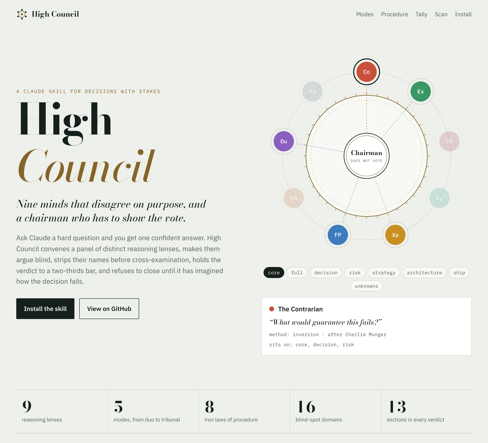
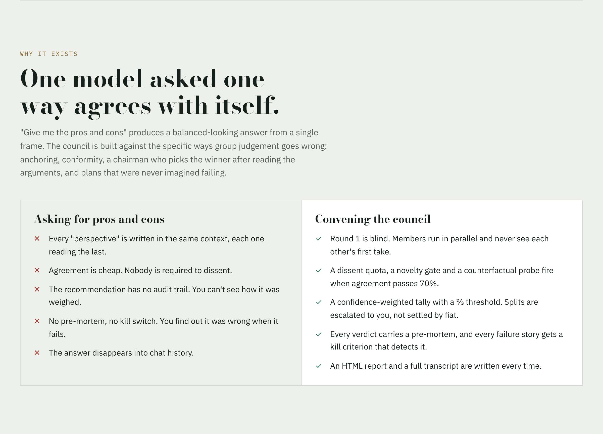
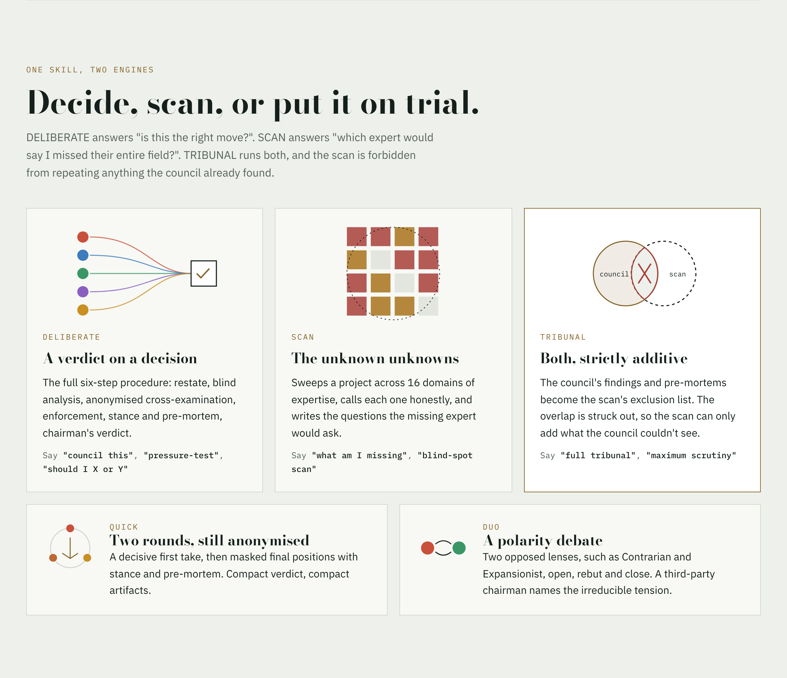
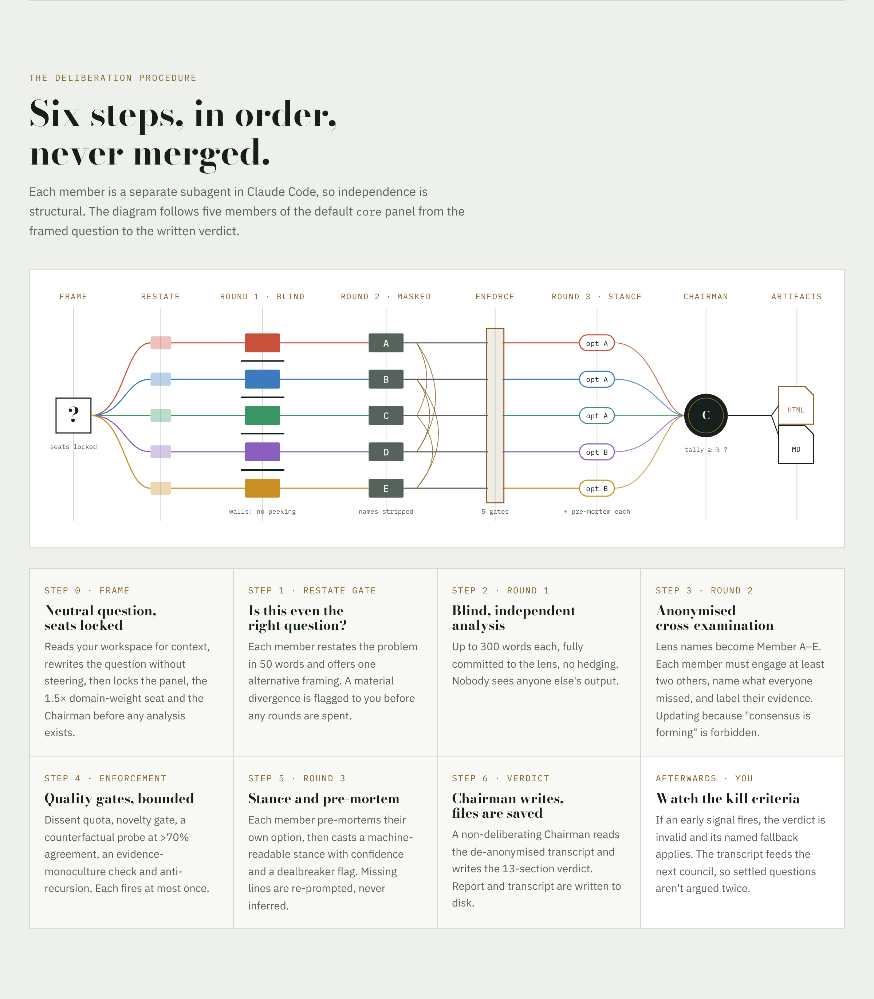
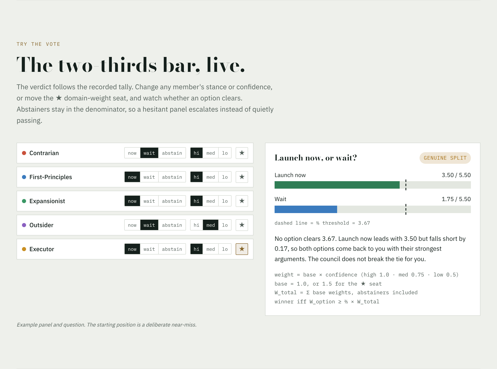
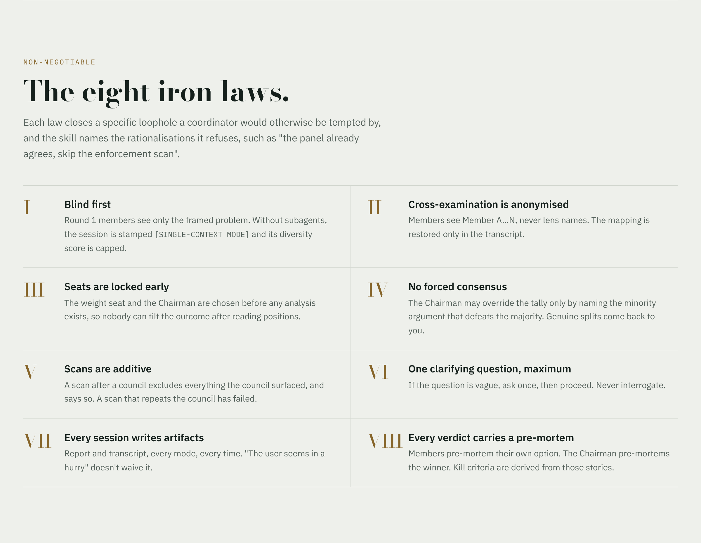
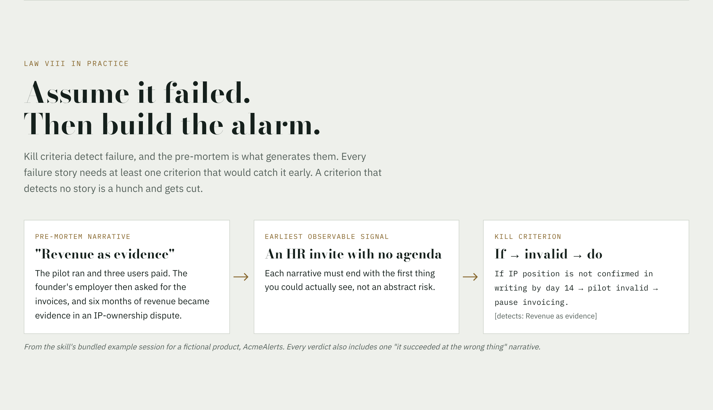
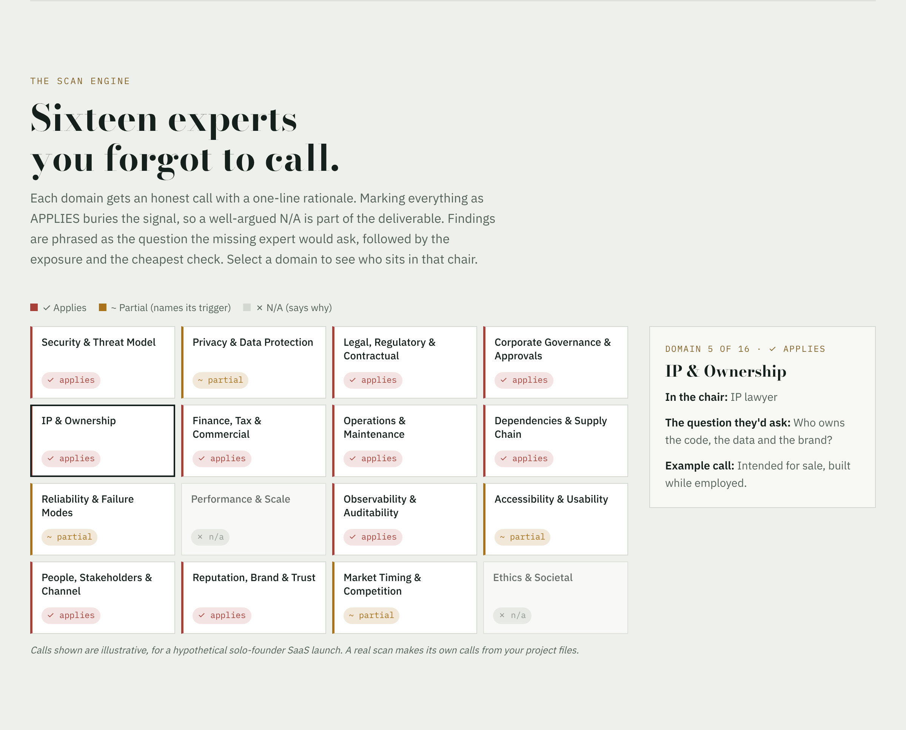
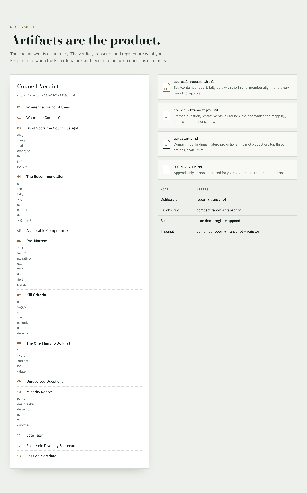

<a href="https://tpflegionaire.github.io/highcouncilskill/">
  <picture>
    <source media="(prefers-color-scheme: dark)" srcset="docs/img/hero-dark.png">
    
  </picture>
</a>

<p align="center">
  <a href="https://tpflegionaire.github.io/highcouncilskill/"><b>Open the interactive showcase →</b></a>
  &nbsp;·&nbsp; <a href="#install">Install</a>
  &nbsp;·&nbsp; <a href="#use">Use</a>
  &nbsp;·&nbsp; <a href="LICENSE">MIT</a>
</p>

**High Council** is a [Claude skill](https://docs.claude.com/en/docs/agents-and-tools/agent-skills/overview) for decisions with stakes. Instead of one confident answer, it convenes a panel of distinct reasoning lenses, makes them argue blind, strips their names before cross-examination, holds the verdict to a two-thirds bar, and refuses to close until it has imagined how the decision fails.

## Why it exists

<a href="https://tpflegionaire.github.io/highcouncilskill/#why">
  <picture>
    <source media="(prefers-color-scheme: dark)" srcset="docs/img/why-dark.png">
    
  </picture>
</a>

## Five modes, two engines

<a href="https://tpflegionaire.github.io/highcouncilskill/#modes">
  <picture>
    <source media="(prefers-color-scheme: dark)" srcset="docs/img/modes-dark.png">
    
  </picture>
</a>

## The procedure

Six steps, in order, never merged. In Claude Code every member runs as a separate subagent, so blind-first independence is structural, not a promise.

<a href="https://tpflegionaire.github.io/highcouncilskill/#procedure">
  <picture>
    <source media="(prefers-color-scheme: dark)" srcset="docs/img/procedure-dark.png">
    
  </picture>
</a>

## The two-thirds bar

The verdict follows a confidence-weighted tally. Abstainers stay in the denominator, so a hesitant panel escalates to you instead of quietly passing. [Try it live](https://tpflegionaire.github.io/highcouncilskill/#tally).

<a href="https://tpflegionaire.github.io/highcouncilskill/#tally">
  <picture>
    <source media="(prefers-color-scheme: dark)" srcset="docs/img/tally-dark.png">
    
  </picture>
</a>

## The eight iron laws

<a href="https://tpflegionaire.github.io/highcouncilskill/#laws">
  <picture>
    <source media="(prefers-color-scheme: dark)" srcset="docs/img/laws-dark.png">
    
  </picture>
</a>

## Every verdict carries a pre-mortem

<a href="https://tpflegionaire.github.io/highcouncilskill/#premortem">
  <picture>
    <source media="(prefers-color-scheme: dark)" srcset="docs/img/premortem-dark.png">
    
  </picture>
</a>

## The scan: sixteen experts you forgot to call

<a href="https://tpflegionaire.github.io/highcouncilskill/#scan">
  <picture>
    <source media="(prefers-color-scheme: dark)" srcset="docs/img/scan-dark.png">
    
  </picture>
</a>

## What you get

<a href="https://tpflegionaire.github.io/highcouncilskill/#output">
  <picture>
    <source media="(prefers-color-scheme: dark)" srcset="docs/img/output-dark.png">
    
  </picture>
</a>

<h2 id="use">Use</h2>

Just say what you're weighing. The skill routes on plain language:

| You say | It runs |
|---|---|
| *"Council this: launch now at £99/mo, or wait for self-serve?"* | **DELIBERATE** with the `core` panel |
| *"Quick council: pgvector or a dedicated vector DB?"* | **QUICK** with the `architecture` triad |
| *"What am I missing on this project?"* | **SCAN** across 16 domains |
| *"Full tribunal: should I take this deal?"* | **TRIBUNAL**: council, then an additive scan |
| *"Have the Contrarian and the Expansionist debate this."* | **DUO** polarity debate |

Panel presets: `core` · `full` · `decision` · `risk` · `strategy` · `architecture` · `ship` · `unknowns`.

It stays out of the way for yes/no questions, lookups, writing tasks and low-stakes "should I". It never runs a partial council.

<h2 id="install">Install</h2>

**Claude Code** (recommended: members run as true parallel subagents)

```bash
git clone https://github.com/TPFLegionaire/highcouncilskill.git
cp -r highcouncilskill/high-council ~/.claude/skills/
```

For a single project, copy it into `.claude/skills/` inside that repo instead.

**Claude.ai and the desktop app**: zip the `high-council` folder on its own and upload it under Settings → Capabilities → Skills. Without subagents the council runs in a clearly labelled `[SINGLE-CONTEXT MODE]`.

```
high-council/
├── SKILL.md                  procedure, modes, iron laws
└── references/
    ├── members.md            nine personas + grounding rules
    ├── prompt-templates.md   every dispatch + enforcement prompt
    ├── domain-taxonomy.md    16 scan domains + probes
    ├── report-templates.md   verdict, HTML report, register formats
    └── example-session.md    an annotated tribunal run
```

No dependencies, no API keys.

## Credits

Designed and written by [TPFLegionaire](https://github.com/TPFLegionaire). Builds on Andrej Karpathy's LLM Council idea and adapts protocol mechanisms from [0xNyk/council-of-high-intelligence](https://github.com/0xNyk/council-of-high-intelligence) (MIT).

## License

[MIT](LICENSE)
